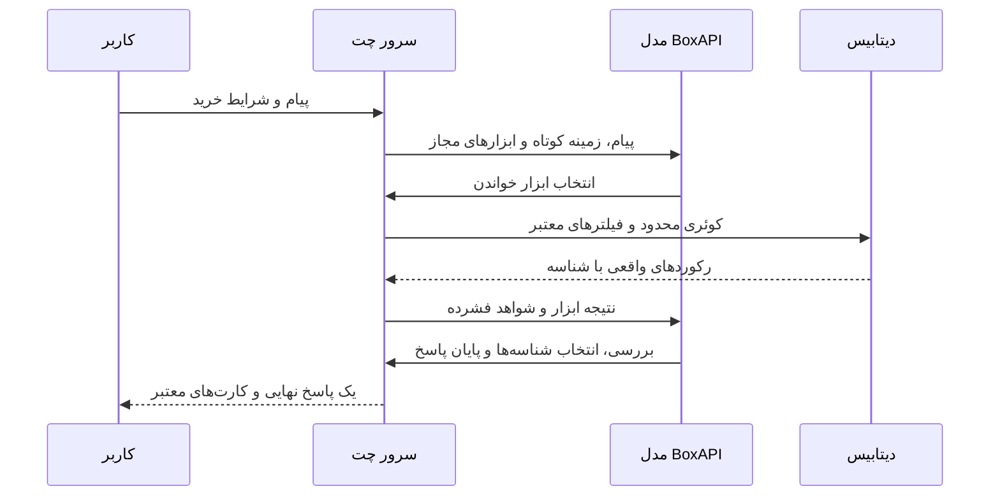

# معماری ترب‌چت

## یک دیتابیس، دو پروفایل اجرا

Next.js App Router رابط فارسی/RTL و APIهای هم‌مبدأ را اجرا می‌کند. پروفایل‌های optimized و boxapi همان کد را با تنظیمات خصوصی جدا اجرا می‌کنند. `/` به `/chat` هدایت می‌شود؛ صفحات جزئیات، مقایسه، مراجعه و نقشه از API و DB مشترک استفاده می‌کنند.

CSVها تنها در مرحلهٔ import به PostgreSQL/PGlite وارد می‌شوند. برای هر پیام، LLM از طریق function calling دادهٔ محدود و مرتبط را می‌خواند؛ هیچ دسترسی مستقیم به filesystem یا SQL دلخواه ندارد. ارسال کل دیتاست لازم نیست.

## مرزهای کد

- `src/lib/agent/provider.ts`: درخواست مدل، ابزارهای محدود، کنترل شناسه‌ها، سقف مصرف و پایان نوبت پس از بررسی شواهد.
- `src/lib/agent/orchestrator.ts`: session، حالت قطعی و ساخت پاسخ نهایی؛ هیچ بلوک جست‌وجوی میانی منتشر نمی‌کند.
- `src/lib/agent/tools.ts` و `schemas.ts`: ورودی/خروجی Zod و دسترسی تایپ‌شده به رکوردهای DB.
- `src/lib/store-discovery.ts`: جست‌وجوی محدود با پیوند واقعی محصول/پیشنهاد/فروشگاه و خواندن فروشندگان در batchهای حداکثر چهارتایی.
- `src/lib/agent/result-window.ts`: سقف پنج پیشنهاد و جلوگیری از تکرار فروشگاه.
- `src/lib/chat-stream.ts`: پیام وضعیت، رویداد ابزار، سپس متن نهایی قطعه‌بندی‌شده و پاسخ canonical؛ این قطعه‌بندی، stream خام توکن‌های سرویس نیست.
- `src/components/chat-screen.tsx`: کارت‌ها فقط با دریافت پاسخ canonical وارد UI می‌شوند. تاریخچهٔ ناقص ذخیره نمی‌شود.
- `src/components/location.tsx`: بارگیری نقشه فقط در مرورگر و به‌صورت dynamic. تب پیگیری نیز جداگانه بارگیری می‌شود.

## پایان معتبر مدل

هر ابزار نتیجهٔ compact با شناسه، قیمت ثبت‌شده، مشخصات محدود و وضعیت نامشخص موجودی برمی‌گرداند. مدل باید نتیجه را در درخواست بعدی بخواند. `finishShoppingTurn` در همان پیام کنار ابزاری که تازه اجرا شده، برای آن شواهد پایان معتبر نیست. شناسه‌های اختیاری `offer_ids` و `product_ids` فقط از شواهد ارسال‌شده انتخاب می‌شوند؛ همهٔ مقادیر کارت از اشیای معتبر قبلی نگه داشته می‌شوند. متن مدل به راهنمای غیرواقعیتی محدود است؛ قیمت، موجودی و هویت فروشنده از متن آزاد استخراج نمی‌شود.

پایان قبل از بررسی با `review_incomplete` مشخص می‌شود. timeout، مجوز نامعتبر، سهمیهٔ محلی و محدودیت سرویس پیام‌های مجزا دارند. fallback همان محدودیت‌های خرید و منبع داده را حفظ می‌کند و به‌عنوان پاسخ کامل LLM معرفی نمی‌شود. درخواست مستقیم از کنترل کارت از ابتدا بدون مدل است و برچسب مخصوص دارد.

## داده، حریم و استقرار

PGlite برای اجرای محلی تک‌فرایندی است؛ PostgreSQL برای چند فرایند/نسخه مناسب است. schema و indexها در `src/lib/db` هستند؛ import شناسه‌ها را حفظ می‌کند و آمار کامل را بررسی می‌کند. تماس‌های ساختگی وارد مسیر outreach واقعی نمی‌شوند. قیمت به تومان، ساعت گزارش‌شده و stock نامشخص باقی می‌ماند.

کلیدها در محیط سرور هستند. JSON ابزار اعتبارسنجی می‌شود، مبدأ و حجم درخواست محدودند و SQL پارامتری است. React کارت‌ها را رندر می‌کند؛ HTML مدل اجرا نمی‌شود. نقشه/عکس کالا تابع دسترسی شبکه هستند و در خرابی شبکه جایگزین متنی دارند.

بستهٔ انتشار فقط سورس allowlistشده را نگه می‌دارد؛ داده، archive، DB، کلید و خروجی build حذف می‌شوند. این workspace استقرار عمومی ندارد. [وضعیت واقعی](../STATUS.md) و [راهنمای دو نسخه](versions.md) مرجع اجرای جاری‌اند؛ مستندات قدیمی 9router تاریخچه‌اند.
